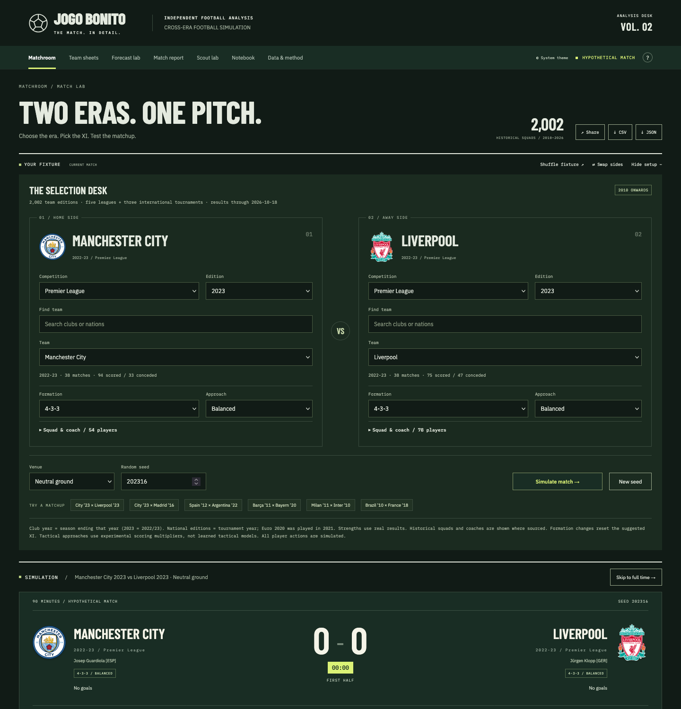

# Jogo Bonito

A football match simulator and scouting workbench built on 31,412 real results and 2,002 historical squads, running entirely in the browser.



**[jogo-bonito-gamma.vercel.app](https://jogo-bonito-gamma.vercel.app)**

Pick any two team editions from 2010–2026 — Manchester City 2023 against Real Madrid 2016, Spain 2012 against Argentina 2022 — choose formations, approach and venue, and replay the result minute by minute. The Scout lab ranks current under-21 players against the clubs they fit, using two models trained on the repository's own data.

## Run

Requires Python 3.10+. No dependencies, API keys or paid feeds.

```sh
python3 server.py        # http://127.0.0.1:8000
npm test                 # Python and JavaScript suites
npm run lint             # eslint + ruff
```

Linting needs `npm install` and `ruff` (`pip install ruff`, or a virtualenv).

`dist/` is a static site: serve it over HTTP and everything works, including the models.

## How it works

Each team edition gets an attack and defence rating from its real goals scored and conceded, normalised against that competition's scoring average, with an eight-match prior pulling small samples toward the mean. Two ratings combine with a venue factor and a tactical multiplier into expected goals for each side, and a seeded generator samples shots, shot quality and passes from there. The same seed always reproduces the same match.

The Scout lab adds two supervised models, fitted offline by `scripts/build_scouting.py` and run in the browser from exported weights. A ranker predicts which club a player moves to next, trained on 5,327 observed club-to-club moves. A classifier projects which calibre of squad a player first seen at 21 or younger appears on two to six seasons later. Both are validated on a forward split in time.

Full detail in [docs/methodology.md](docs/methodology.md).

## Evaluation

The match engine, scored on 12,291 held-out matches from 85 league editions. Each season is split by date: the first 60% fits each contender, the rest is predicted.

| Model | Log loss | Brier | Top pick |
| --- | ---: | ---: | ---: |
| Shipped engine — goal ratios, eight-match prior | **0.9956** | **0.5938** | 51.6% |
| Dixon-Coles MLE, fitted per edition | 1.0009 | 0.5966 | 51.5% |
| Fitted MLE without low-score correction | 0.9998 | 0.5963 | 51.6% |
| Training-split home/draw/away frequencies | 1.0681 | 0.6457 | 45.1% |
| Uniform guess | 1.0986 | 0.6667 | 45.1% |

Lower is better for log loss and Brier. A fitted Dixon-Coles alternative was tried and lost; the eight-match prior was already doing the regularising that maximum likelihood had to be forced into, so the engine was left alone.

The scouting ranker places the true destination in its top five 20.8% of the time against ~96 candidates per season, versus 6.4% for ranking by closest club level. The progression classifier scores 50.7% accuracy against a 46.8% majority baseline, calibrated within 5 percentage points on every class.

## Known limitations

- **Cross-era matchups have no ground truth.** The evaluation above covers ordinary league fixtures. City 2023 against Madrid 2016 cannot be scored against anything, and league strengths are not calibrated against each other.
- **Squad lists carry no minutes, fees or valuations.** Player selection changes who events are attributed to, not how strong a team is. Coaches are displayed but not modelled.
- **"No further top-five season" means unobserved, not failed.** A move to a league outside the bundled five is indistinguishable from leaving football.
- **Fit is learned from where players actually moved**, so it reflects the recruitment market rather than merit, and cannot separate a loan from a transfer.
- **There is no academy data.** The prospect pool is the under-21 players inside senior squad lists, which is the youngest cohort these sources can see.

## Data

Results from [OpenFootball](https://github.com/openfootball/football.json), [FootballCSV / Soccerverse](https://github.com/footballcsv/cache.soccerverse) and [Mart Jürisoo's international results](https://github.com/martj42/international_results), all CC0. The catalog records source URLs, SHA-256 hashes, per-edition match counts and completeness.

Squads from [FootballSquads](http://www.footballsquads.co.uk/). Material © FootballSquads.com, 1999–, all rights reserved, used for this non-commercial project under the source's [terms of use](https://www.footballsquads.co.uk/tou.htm). Not covered by the CC0 licensing of the result datasets.

Flags from [flag-icons](https://github.com/lipis/flag-icons) (MIT). Club badges remain the property of their respective owners; provenance and per-edition mappings are in `dist/assets/crests/clubs.json`.
