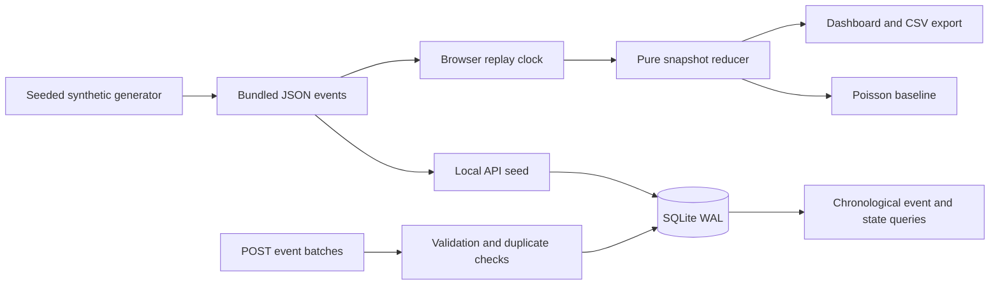

# Architecture and implementation boundary

## Current

SQLite's primary key makes repeated IDs idempotent. Identical retries return duplicate counts; conflicting payloads reject and roll back the entire batch. Events are reconstructed by `(minute, id)` rather than arrival order, so late events appear in subsequent snapshots. SQLite transactions provide local persistence; recovery is verified by closing and reopening the store. This is not a distributed queue, checkpoint system, or consumer-crash recovery implementation.

The hosted site is static. Its replay clock selects an event-time prefix of the bundled JSON, and a pure reducer derives every visible statistic. This avoids time-dependent random numbers and gives deterministic seeking. Pausing controls the local clock rather than a server stream. The Python API separately demonstrates ingestion and event persistence.

## Next implementation stages

1. Add an importer for an explicitly licensed dataset with provenance, schema versioning, match metadata, coordinates, and stable event IDs. Retain the synthetic fixtures as a demo mode.
2. Extract storage into PostgreSQL. Add Redis Streams with consumer groups, pending-message recovery, durable offsets, dead-letter handling, and transactional idempotency. Test process termination and duplicate redelivery.
3. Make a FastAPI service the authoritative snapshot producer; publish versioned WebSocket updates with reconnect/reconciliation. Connect browser replay controls to server sessions.
4. Train baseline xG and outcome models using chronological splits. Record calibration, Brier score, log loss, dataset lineage, and comparisons to simple reference predictions. Keep training and test matches disjoint.
5. Instrument processing and delivery stages. Run reproducible load and fault-injection tests, report hardware and observed latency/throughput, and only then compare with the proposal's targets.

## Tradeoffs

A dependency-free local implementation offers a reproducible starting point and immediately usable dashboard. It deliberately postpones distributed infrastructure and trained-model claims until those systems can be implemented and measured. Static hosting makes the demo portable but does not host Python, SQLite, or a real-time inference service.
