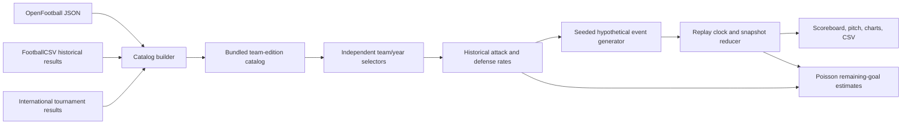

# Architecture

`build_catalog.py` imports club seasons ending 2010 onward and exact World Cup, Euros and Copa América tournament editions, excluding unplayed fixtures and dates after the requested cutoff. OpenFootball has priority for modern club seasons; FootballCSV/Soccerverse fills missing older files. No results are merged across competing sources for the same edition. Per-edition coverage and whole-source SHA-256 hashes are retained.

Each club edition is the entire league season ending in the displayed year, not a calendar-year average. National editions reflect the specified tournament only. Team goals for/against per match are shrunk toward their competition average using an eight-match prior, then normalized into attack and defensive conceding factors. This is an interpretable heuristic baseline with explicit coverage and sample-size information.

`simulator.js` combines independent edition strengths and venue settings into expected goals. The seeded PRNG, Poisson shot count, shot xG and goal draws produce a deterministic hypothetical event timeline. Shots and passes use anonymous units because historical rosters are absent. `engine.js` reconstructs every visible statistic from the selected timeline prefix. Outcome probabilities use the actual simulated score and remaining time with fixed pre-match rates. Changing a seed restarts at minute zero; seeking never generates new random numbers.

Cross-competition comparisons assume equal normalized competition strength. The model is not a fitted player-level model or validated forecast. International source scores may include extra time. There is no extra-time or penalty-shootout simulation. The Methodology view exposes these limits and partial source coverage.

The static site needs no runtime backend or API key. URL parameters preserve scenario configuration; CSV preserves generated events. The local Python server retains the separate legacy SQLite event-ingestion demonstration: atomic batch validation, same-ID idempotency, conflicting-ID rollback, and chronological replay snapshots. It does not persist browser simulations or serve a distributed event queue.

## Next steps

Add historical squad provenance and lineup selection; fit opponent- and competition-adjusted attack/defense ratings; evaluate held-out chronological fixtures and calibration; connect durable simulation sessions to the API; then add PostgreSQL, Redis consumers and WebSocket delivery with process-failure tests. Publish measured benchmarks only after reproducible load testing.
