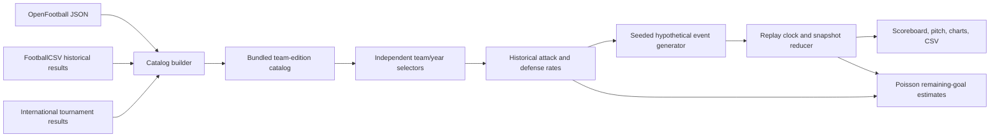

# Architecture

`build_catalog.py` imports club seasons ending 2010 onward and exact World Cup, Euros and Copa América tournament editions, excluding unplayed fixtures and dates after the requested cutoff. OpenFootball has priority for modern club seasons; FootballCSV/Soccerverse fills missing older files. No results are merged across competing sources for the same edition. Per-edition coverage and whole-source SHA-256 hashes are retained.

Each club edition is the entire league season ending in the displayed year, not a calendar-year average. National editions reflect the specified tournament only. Team goals for/against per match are shrunk toward their competition average using an eight-match prior, then normalized into attack and defensive conceding factors. This is an interpretable heuristic baseline with explicit coverage and sample-size information.

`simulator.js` combines independent edition strengths and venue settings into expected goals. The seeded PRNG, Poisson shot count, shot xG and goal draws produce a deterministic hypothetical event timeline. Historical FootballSquads snapshot files are lazy-loaded per edition. Each side independently stores a valid playing XI. A separate seeded attribution stream assigns shots and passes to selected players using position weights, preserving the numerical event timeline and baseline goal rates. Missing sourced rosters retain anonymous units. Recorded source coaches are displayed without claiming complete managerial tenure histories. `engine.js` reconstructs every visible statistic from the selected timeline prefix. Outcome probabilities use the actual simulated score and remaining time with fixed pre-match rates. Changing a seed restarts at minute zero; seeking never generates new random numbers.

Cross-competition comparisons assume equal normalized competition strength. The model is not a fitted player-level model or validated forecast. International source scores may include extra time. There is no extra-time or penalty-shootout simulation. The Methodology view exposes these limits and partial source coverage.

The static site needs no runtime backend or API key. URL parameters preserve scenario configuration; CSV preserves generated events. The local Python server retains the separate legacy SQLite event-ingestion demonstration: atomic batch validation, same-ID idempotency, conflicting-ID rollback, and chronological replay snapshots. It does not persist browser simulations or serve a distributed event queue.

## Next steps

Extend dated transfer eligibility and complete managerial tenures; fit opponent- and competition-adjusted attack/defense ratings; evaluate held-out chronological fixtures and calibration; connect durable simulation sessions to the API; then add PostgreSQL, Redis consumers and WebSocket delivery with process-failure tests. Publish measured benchmarks only after reproducible load testing.

Squad data is a separate non-commercial-attribution dataset, not part of the CC0 result sources. The importer caches pages, constrains concurrency, uses exact audited team aliases within competition/year, records source hashes and gaps, and packages one JSON file per edition plus a lightweight manifest. Suggested XIs use positions and source order; no player ability or coach tactical effect is claimed. Both original and selected departed-player statuses remain explicit.

Light/dark mode is CSS-native via `prefers-color-scheme`; semantic SVG colours reference CSS variables so live system changes do not require regenerating charts or resetting replay state.

## Match Lab expansion (model historical-v3)

`lab-engine.js` contains pure score-matrix, seeded score-batch, historical-comparison and player-ledger reducers. `lab.js` owns the dedicated workspaces, formation diagrams, result notebook and downloads. The app keeps one canonical current simulation; uncommitted configuration edits are marked separately. XIs, formations, tactics, venue and seed are serialized into share links. A generation token prevents stale asynchronous squad loading from replacing a newer requested simulation.

Approaches apply documented attack/exposure multipliers before rate bounds, independently for each side. Balanced mode preserves the previous scoring baseline. Formation changes choose an available positional XI and affect layout; there are no learned formation or coach effects. Batch runs sample independent Poisson scorelines rather than thousands of event streams, so 10,000 experiments are practical without blocking on millions of DOM updates. Exact probability grids aggregate all 6+ scores, preserving probability mass.

The report reducer uses only the current replay prefix. Player totals agree with event counts, and highlight/event controls seek rather than generate new events. Playback rendering is capped to roughly eight updates per second. Saved configurations and completed results are bounded browser-local storage collections; failures are surfaced and no backend persistence or identity is implied.
